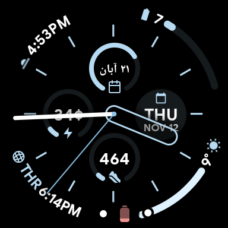
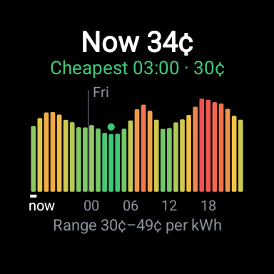

# Tibber Price complication for Wear OS

Shows your current [Tibber](https://tibber.com) electricity price in a complication slot of any Wear OS watch face, including the stock Pixel Watch faces. Tap it to see the price graph for the rest of today and tomorrow, so you can pick the cheapest hour to run the dishwasher or washing machine.

 

## What it shows

**The complication** (ranged value)
- Text: the current hour's price in cents, e.g. `34¢`. This is Tibber's `total`, so it includes energy tax and VAT.
- Arc: where the current price sits within today's range. Empty means today's cheapest hour, full means today's most expensive.
- Some faces color the arc green → yellow → red (Wear OS 4+ color ramp); others, like the Pixel faces, use their own theme color.
- Also available as a short-text complication for faces that don't have ranged-value slots.

**The graph** (tap the complication)
- One bar per hour from now until the last published price (tomorrow's prices are usually out around 13:00 CET).
- Bars are colored cheap → expensive, and their height starts at 0¢, so the size of the differences is honest.
- The header shows the current price and the cheapest hour still ahead. A green dot marks that hour.
- Swipe right to close.

## How it works

- Prices come from the [Tibber GraphQL API](https://developer.tibber.com/docs/overview) (`priceInfo.today` and `priceInfo.tomorrow`, hourly).
- They're cached on the watch. The app only goes online when the current hour isn't in the cache, or once after 13:00 to pick up tomorrow's prices. That's about twice a day.
- The watch face asks for a new value every 5 minutes. That's served from the cache, so it costs almost no battery.
- If the watch is offline, it keeps showing the last prices it has.
- Times are in `Europe/Amsterdam`.

The watch talks to Tibber directly over Wi-Fi or through the paired phone's connection. No phone app is needed.

## Requirements

- A Wear OS 3+ watch (tested on a Pixel Watch 2, Wear OS API 37)
- A Tibber account with an active electricity contract
- A Tibber API token from [developer.tibber.com](https://developer.tibber.com) (log in → *Access token*)
- JDK 17+ and the Android SDK (platform 35, build-tools 35), or Android Studio

## Build and install

1. Put your token in `local.properties` in the project root. This file is git-ignored, so the token never ends up in the repo:
   ```properties
   sdk.dir=/path/to/Android/Sdk
   tibber.token=YOUR_TIBBER_TOKEN
   ```
   The token is compiled into the APK. Don't share builds made with your token.

2. Enable debugging on the watch: *Settings → System → About → tap Build number 7 times*, then *Developer options → Wireless debugging* on. The watch and computer must be on the same Wi-Fi.

3. Pair and connect. On the watch, tap *Pair new device* and use the IP:port and code it shows:
   ```sh
   adb pair <watch-ip>:<pairing-port> <code>
   adb connect <watch-ip>:<port shown on the main Wireless debugging screen>
   ```
   If you don't know the ports, `adb mdns services` lists them.

4. Build and install:
   ```sh
   ./install.sh
   ```
   `install.sh` expects JDK 21 in `~/.local/opt/jdk21` and the SDK in `~/Android/Sdk`. Edit the two paths at the top if yours are elsewhere. Or run `./gradlew :wear:installDebug` with `JAVA_HOME` and `ANDROID_HOME` set.

5. On the watch: long-press the face → *Customize* → tap a complication slot → *Tibber Price → Power price*.

## Project layout

```
wear/src/main/java/app/tibberprice/
  TibberPrices.kt               Tibber API client and on-watch cache
  PriceComplicationService.kt   Complication data source (ranged value / short text)
  PriceGraphActivity.kt         Price graph opened by tapping the complication
wear/src/main/AndroidManifest.xml
install.sh                      Build and install over adb
```

## Limitations

- Hourly prices only. Tibber also offers quarter-hour prices, which this app doesn't use yet.
- If your account has several homes, the first home with an active subscription is used.
- The token is baked in at build time. There's no on-watch settings screen.

## License

[MIT](LICENSE)

This project isn't affiliated with or endorsed by Tibber.
